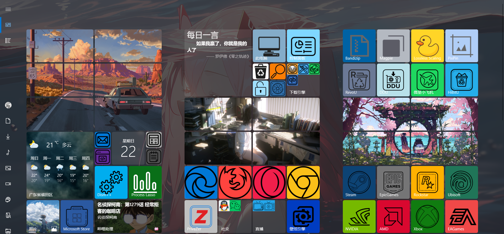
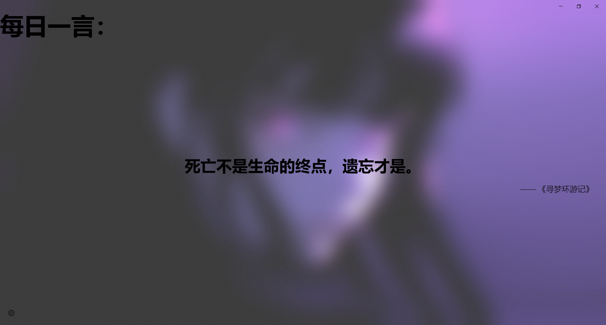

# 一言 Tile

Windows 10 / 11 桌面磁贴：每小时给你一句「一言」。

<p align="center">
  <a href="https://bzhcyy.github.io/OneSentenceTile/"><b>磁贴服务器</b></a> ·
  <a href="https://github.com/bzhcyy/OneSentenceTile/releases">Releases</a> ·
  <a href="https://developer.hitokoto.cn/">一言 API</a>
</p>

---

## 磁贴长什么样

开始菜单磁贴：



软件最大化：



```
每日一言：
　　死亡不是生命的终点，遗忘才是
　　　　　　　　—— 《寻梦环游记》
```

版式（默认值，可在设置里改）：

| 位置 | 内容 | 字号 | 对齐 |
|---|---|---|---|
| 第一行 | 「每日一言：」标题 | 24 | 靠左 |
| 中间 | 一言正文，前空两格 | 15 | 折行居中 |
| 右下 | 出处「—— 作者《作品》」 | 12 | 靠右，最多两行 |

磁贴整体透明，背景是系统的亚克力磨砂；标题和出处可以单独关掉，三段字号/对齐都能调。

## 功能

| | |
|---|---|
| **分类** | 随机 / 动画 / 漫画 / 游戏 / 文学 / 原创 / 网络 / 其他 / 影视 / 诗词 / 网易云 / 哲学 / 抖机灵 |
| **刷新** | 实时（现拉现推，默认）/ 30 分钟 / 1 / 6 / 12 / 24 小时；任何模式下改完都会立刻推一次 |
| **三源** | 官方一言（`v1.hitokoto.cn`，默认）/ Worker 实时源 / Pages 静态快照，设置里三选一；选中的取不到就自动按下一个换，Pages 快照过期时直接跳过，不会停在几小时前那条 |
| **磁贴文字** | 标题 / 正文 / 出处 各自字号、对齐（左/中/右）、显示开关；XML 由 App 本地重建，两源都生效 |
| **界面文字** | 字体（含系统字体选择框 + 未知字体自动回退）、三段字号、加粗 |
| **壁纸** | 关闭 / 本地图片 / 网络地址 / 文件夹轮播（1–60 分钟） |
| **外观** | 背景色 + 透明度（壁纸 / 全屏同样生效：0 是原图 / 桌面，100 是纯背景色）、字体色、全屏、屏幕常亮 |

## 默认设置

| 项 | 默认值 |
|---|---|
| 动态磁贴 | 开 |
| 磁贴源 | 官方一言（v1.hitokoto.cn） |
| 刷新间隔 | 实时 |
| 标题 / 正文 / 出处 | 24 / 15 / 12 |
| 对齐 | 标题靠左、出处靠右 |
| 壁纸 | 关闭 |
| 界面字号 | 标题 60 加粗、正文 40 加粗、出处 20 常规 |

设置存在 `RoamingSettings`，升级后带一次性迁移（`settingsRev`），改默认值也能生效。

## 安装

下载 Release 里的 `uwp-package.zip`，解压后**双击 `安装.cmd`**：

1. 自动请求管理员权限
2. 证书 → 受信任人
3. 依赖框架 → `Dependencies\x64\*.appx`
4. 主程序包 → `Add-AppxPackage`

> 1.3.36 起包标识改为 `KienSticn.OneSentenceTile2`。如果装过旧版，请先在「设置 → 应用」里卸载旧版；旧标识的激活注册一旦损坏，会出现 `0x80270254`，重装同一标识也没用。

手动等价操作：

```powershell
Import-Certificate -FilePath .\OneSentenceTile_TemporaryKey.cer -CertStoreLocation Cert:\LocalMachine\TrustedPeople
Add-AppxPackage -Path .\Dependencies\x64\Microsoft.NET.CoreRuntime.1.1.appx
Add-AppxPackage -Path .\Dependencies\x64\Microsoft.VCLibs.x64.14.00.appx
Add-AppxPackage -Path .\OneSentenceTile_*_x64.appxbundle -ForceUpdateFromAnyVersion
```

免证书（需开「开发人员模式」）：

```powershell
powershell -ExecutionPolicy Bypass -File .\install-app.ps1 -Register
```

### 报错对照

| 报错 | 原因 | 处理 |
|---|---|---|
| `0x80073CF3` 找不到框架 | 依赖没装 | 先装 `Dependencies\<arch>\*.appx` |
| `0x80270254` 点了没反应 | 旧包标识的激活注册损坏（重装同标识无效） | 卸载旧版，安装 1.3.36+（包标识已改为 `KienSticn.OneSentenceTile2`） |
| 证书缺少基本约束扩展 | 证书装进了「受信任的根」 | 改装「受信任人」 |
| `APPX0107` 签名无效 | 用了 CA 证书签名 | 用 `-Type CodeSigningCert` 的证书 |

## 构建

推送即触发 Actions → `Build UWP package` → 下载 `uwp-package`；Job Summary 会列出本次版本、产物、安装步骤。

打 Release：推 `v*` tag。

```bash
git tag v1.3.36 && git push origin v1.3.36
```

本地构建（需 VS 2022 + UWP 工作负载）：

```powershell
powershell -ExecutionPolicy Bypass -File .\build-uwp.ps1 -Configuration Release -NoDotNetNative
```

签名证书缓存在 Actions `build/cert`（key `uwp-dev-cert-v9`），缓存不清证书就不变，升级不用重装证书。想长期固定：把 `signing-cert` 工件里的 `.pfx`/`.cer` 存本地，或放进仓库 Secrets `SIGNING_PFX_BASE64`。

## 磁贴服务器

设置面板里「磁贴源」是个下拉框，三选一：

| | 地址 | 特点 |
|---|---|---|
| 官方一言（默认） | `https://v1.hitokoto.cn` | 直连 JSON，App 自己拼磁贴；国内一般可达，但系统「周期更新」只认 XML，所以 App 关掉后由 Worker 顶替 |
| Worker 实时源 | `https://onesentencetile.onesentencetile.workers.dev/tile.xml` | 每次请求现取，缓存 60 秒；`?type=d` 指定分类 |
| Pages 快照源 | `https://bzhcyy.github.io/OneSentenceTile/tile.xml` | GitHub Actions 生成的静态快照；分类为 `tile-a…l.xml`；首页/健康见 `health.json` |

应用运行时固定按官方一言 API → Cloudflare Worker → GitHub Pages 的顺序尝试；前一个不可用才切换下一个。Pages 快照超过 45 分钟没更新时直接跳过，不推旧内容。Windows 在应用关闭后只能请求 XML，因此后台周期更新固定按 Worker → Pages 回退，无法直接请求返回 JSON 的官方 API。

两端生成的 XML 结构一致：`TileSmall / TileMedium / TileWide / TileLarge` 四个绑定，标题/正文/出处分别用 `hint-style` + `hint-align` 控制。

### 备用源更新延迟是怎么回事

Pages 是纯静态托管，自己不会刷新；`tile.xml` 只在 GitHub Actions 跑的时候才变。
而 Actions 的 `schedule` 是**尽力而为**的（官方文档原话），忙起来会推迟甚至跳过。
本仓库实测的定时运行间隔：

```
11-22 16:02 → 21:47   5 小时 45 分
11-22 21:47 → 11-23 02:23   4 小时 36 分
11-23 02:23 → 11-23 11:05   8 小时 42 分
```

工作流里写的是 `cron: '*/15 * * * *'`，`health.json` 的 `generatedAt` 却经常是两三个小时前——
所以选了「Pages 快照源」、或者 Worker 连不上（`workers.dev` 在国内经常被墙）时，磁贴就会停在旧的那条。

现在改的是 **Pages 这一侧**（Worker 完全不动，仍然是每次请求现取的实时源）：

1. **App 不再被骗**：选中 Pages 时读 `health.json` 的 `generatedAt`，超过 45 分钟就认为快照过期，
   这时直接跳过 Pages，按顺序改用**一言官方 API**（`v1.hitokoto.cn`，App 自己拼磁贴）或 **Worker** 实时源；
   都失败才沿用旧内容。Pages 请求一律带 `?v=时间戳`，绕开 GitHub Pages 的 10 分钟 CDN 缓存。
   设置面板只显示实际用的源，例如「磁贴源：官方一言」，不提示跳过了谁。
2. **看得见的新鲜度**：`health.json` 多了 `generatedAtUnix` / `refreshMinutes` / `staleAfterMinutes`，
   首页按本地时间显示生成时间、和「已 X 分钟」，超过阈值直接亮黄条；
   `tile/check_freshness.py` 可以随时查线上快照年龄（CI 每次部署前后都会跑）。
3. **工作流自检更严**：部署后的探测都带 `?v=`（原来可能读到 CDN 旧副本「假通过」），
   并确认线上 `health.json` 就是这一次生成的；另外给两个 job 加了超时，
   避免卡住的运行把 concurrency 队列堵死。

> Windows 系统「周期更新」的最短间隔为 30 分钟。App 关闭后，磁贴内容取决于系统周期请求及所选更新源的可用性；Pages 快照还可能受到 GitHub Actions `schedule` 延迟影响。

## 目录

```
OneSentenceTile/        UWP 应用
  MainPage.xaml(.cs)    主界面 + 设置面板
  TileSource.cs         三源选择、兜底顺序、快照新鲜度、样式/对齐参数
  Package.appxmanifest  清单（Identity KienSticn.OneSentenceTile2）
tile/                   磁贴静态站生成器
  gen_tile.py           生成 tile.xml / 13 个分类 / index.html / health.json
  check_freshness.py    查线上快照年龄（CI 部署前后、本地排查都可用）
  config.json           标题、样式、对齐默认值
cloudflare-worker/      Cloudflare Worker 版磁贴（实时，未改动）
.github/workflows/      构建、发布、磁贴生成
build-uwp.ps1           打包脚本（含 CI Summary）
install-app.ps1         安装脚本
docs/                   截图（README 用）
安装.cmd                 一键安装（自动提权）
```

## 许可

GPL-3.0，继承自 [chenxuuu/add-one-second-UWP](https://github.com/chenxuuu/add-one-second-UWP)。


### 默认磁贴字号

新安装默认排版：标题「大 24」（`title`）、正文「标准 15」（`base`）、出处「极小·淡 12」（`captionSubtle`）。Pages 生成配置、Cloudflare Worker 无参数默认值和应用首次启动默认值保持一致。更新 GitHub Pages 需要推送仓库并等待 `tile-pages.yml` 部署完成；更新 Worker 需要重新部署 `cloudflare-worker/worker.js`。
